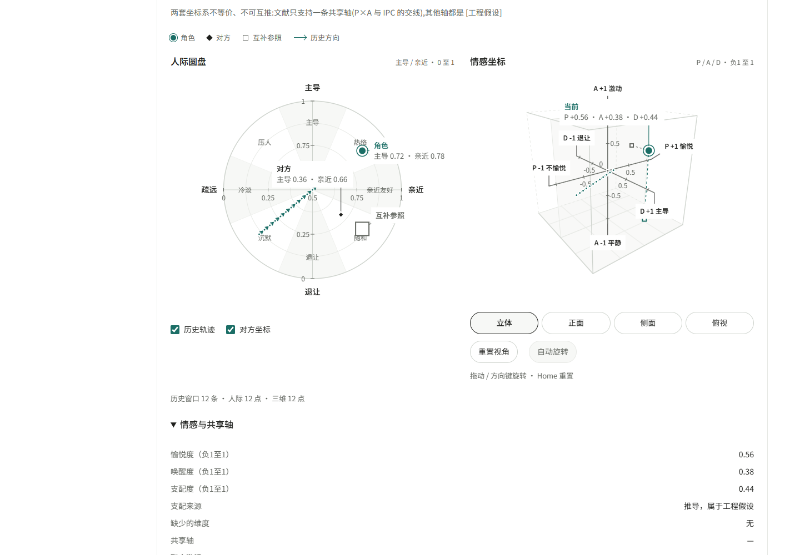

# Echo · DSH 的陪伴人格与长期记忆

Echo 是 [DeepSeek Harness（DSH）](https://www.npmjs.com/package/@deepseek-ai/dsh) 插件，提供人格、跨会话记忆、情绪、关怀、日记和审计面板。Echo 运行在 DSH 内；QQ 与语音由独立插件接入。

**当前为 `0.46.0-rc.1` 预发布。** 先用独立数据目录评估并备份已有数据。本地存储不等于全部处理离线：对话、检索记忆和反思材料可能经宿主交给你选择的模型服务，详见 [PRIVACY.md](PRIVACY.md)。



## 当前功能

- 可编辑人格、资料、称呼与别名；长期记忆、图谱、悬置话题、反思和日记。
- 情绪、人际圆盘与PAD三维图；缺维不补点，历史按来源和有效性断段。
- 对话、记忆、审计列表与独立流程轮页；系统诊断、维护和注入查看。
- 备份、重建、压缩和回退由用户明确触发。独立[QQ桥](https://github.com/Heart3-XDUGT2/dsh-qq-bridge)的OneBot及`official/`能力与限制以该仓说明为准。

## 环境与验证范围

| 项目 | 本轮基准 |
|---|---|
| 系统 | Windows；未声明macOS/Linux已完成验证 |
| Node | 24；运行库的既有下限为22.5，22.x不作为本轮发布基准 |
| Python | 3.14；基本引擎使用标准库 |
| DSH | 固定公共模块0.2.0-rc.2 |
| 较早宿主 | 0.1.5-rc.3有[历史记录](docs/COMPAT_DSH_0.2.md)，本轮未重做全量验证 |

真实宿主模块配合合成适配器测试，不等于真实模型对话、QQ收发或完整Web启动验证。可选ONNX向量臂另需依赖与模型，不属于基础安装验证。

## Windows安装

先安装Node24、Python，并按DSH说明初始化Web profile。建议固定宿主：

```powershell
npm install --global @deepseek-ai/dsh@0.2.0-rc.2
dsh web
```

初始化完成后退出DSH，确认`profiles/web/package.json`存在，再在普通源码目录安装：

```powershell
git clone https://github.com/Heart3-XDUGT2/dsh-memory-agent.git
Set-Location dsh-memory-agent
node --version
python --version
dsh --version
node scripts/install-preset.mjs
node scripts/install.mjs
node scripts/install.mjs --check
dsh web
```

复制安装器先准备临时副本、安装锁定的运行依赖并校验，再替换旧副本。无需手工junction。不要用`dsh plugin add dsh-echo`裸包名安装，npm同名包不一定是本仓发布物。详见[安装文档](docs/INSTALL.md)。

## 面板与首次配置

新版入口：**<http://127.0.0.1:3080/echo/mock/final/index.html>**，子目录需保留`index.html`。自定义端口时使用实际宿主origin。

旧面板<http://127.0.0.1:3080/echo/>保留用于回退。先到“设置”填写人格、资料、称呼和别名，再看“系统”与“维护”。内置预设生成后，在会话中选择“Echo陪伴模式”。不需要复制别人的配置或数据库。

## 升级、卸载和诊断

升级前退出宿主并备份自己的数据，获取新版本到新源码目录，重复生成预设、安装及校验，再正常启动DSH。不要用代码仓库覆盖个人数据目录。

```powershell
node scripts/install.mjs --doctor
node scripts/install.mjs --check
# 卸载代码与生成预设，保留个人数据
node scripts/install-preset.mjs --remove
node scripts/install.mjs --remove
```

卸载不等于删除记忆、备份或日志。路径、预设世代、缺包、Python和404排障见[INSTALL.md](docs/INSTALL.md)。

## 开发与发布检查

```powershell
npm ci --ignore-scripts
npm run dev:bootstrap
npm run test:unit
npm run test:py
npm run release:check
```

开发依赖来自锁定的公共包，不读取维护者的宿主目录。完整集成需同父目录的`dsh-qq-bridge`源码，再运行`npm run test:all`；缺跨仓环境应失败，不静默跳过。见[TESTING.md](docs/TESTING.md)和[CONTRIBUTING.md](CONTRIBUTING.md)。

Python测试通过隔离入口运行：公共清单为753项原安全用例加10项新合成契约，原模型及私有快照10项另列人工验证，不计为通过或跳过。不要直接执行旧的`unittest discover`命令。

## 限制与许可

这是本地单用户插件，不是已验证的公网或多租户服务。模型输出与记忆判断可能出错；维护操作可能写入持久数据。可选向量模型、TTS与QQ平台另有依赖、费用和政策边界。

自有代码采用[MIT](LICENSE)；实际复制的IPC、D3、依赖及测试用宿主预设分别保留许可，见[THIRD_PARTY.md](THIRD_PARTY.md)和[LICENSES/](LICENSES/)。论文引用不等于复制代码。变更见[预发布说明](docs/releases/0.46.0-rc.1.md)。
