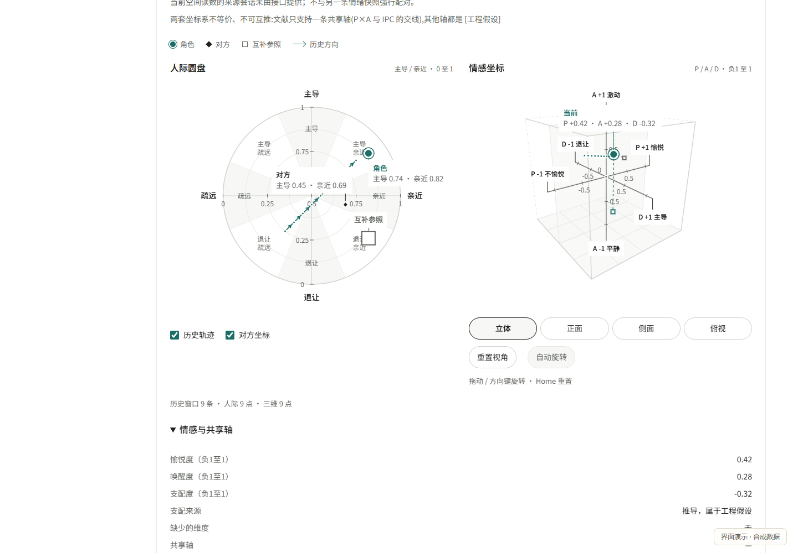
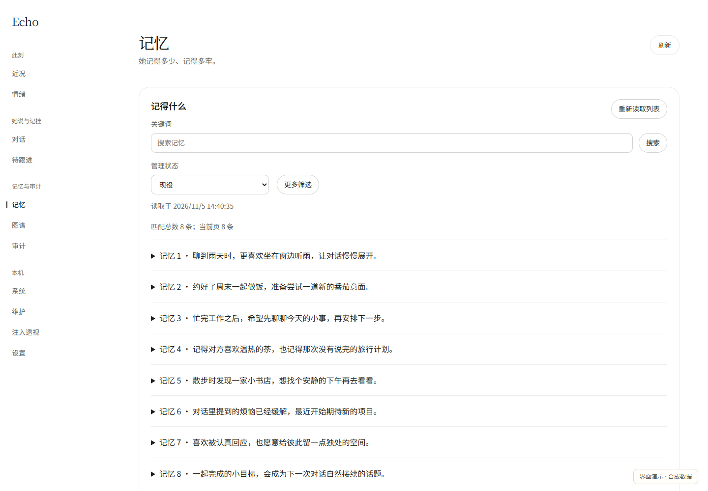
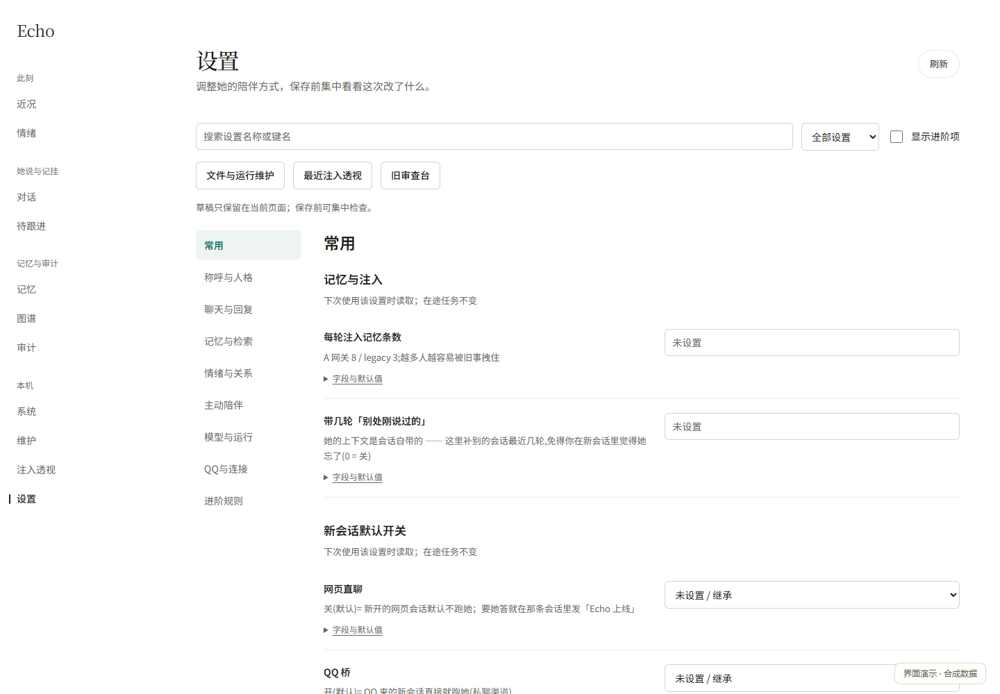
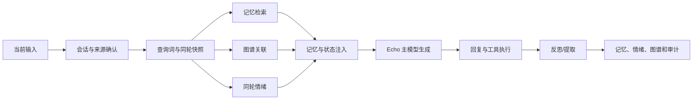

# Echo · DSH 的陪伴人格与长期记忆

**项目队友：[Peirar](https://github.com/Peirar) · [Terabinaryte](https://github.com/Terabinaryte)**

发起与维护：[Yotaoer](https://github.com/Yotaoer)

Echo 是 [DeepSeek Harness（DSH）](https://www.npmjs.com/package/@deepseek-ai/dsh) 插件，提供人格、跨会话记忆、情绪、关怀、日记和审计面板。Echo 运行在 DSH 内；QQ 与语音由独立插件接入。

**当前为 `0.46.0-rc.1` 预发布。** 先用独立数据目录评估并备份已有数据。本地存储不等于全部处理离线：对话、检索记忆和反思材料可能经宿主交给你选择的模型服务，详见 [PRIVACY.md](PRIVACY.md)。

## 界面预览

以下截图均来自隔离演示环境，使用合成数据，不包含真实对话或记忆。

### 情绪与关系



### 长期记忆



### 统一设置



[查看手机端情绪图](docs/images/showcase/04-emotion-mobile.png)


## 当前功能

- 可编辑人格、资料、称呼与别名；长期记忆、图谱、悬置话题、反思和日记。
- 情绪、人际圆盘与PAD三维图；缺维不补点，历史按来源和有效性断段。
- 对话、记忆、审计列表与独立流程轮页；系统诊断、维护和注入查看。
- 备份、重建、压缩和回退由用户明确触发。独立[QQ桥](https://github.com/Heart3-XDUGT2/dsh-qq-bridge)的OneBot及`official/`能力与限制以该仓说明为准。

## Echo 的内部架构

Echo 不是“把最近几轮对话塞进提示词”的薄封装。它把一轮回复拆成几个可以单独检查的阶段：输入归属、检索、状态读取、注入、模型生成、反思和审计。各阶段都尽量保留来源和失败状态，某个增益模块不可用时，基础对话仍有明确的降级路径。



### 1. 输入、会话和一轮快照

每次模型调用首先绑定到当前会话和当前执行轮。`turn-snapshot.js`在消息被宿主认领时记录本轮查询词，随后对检索结果、共享连续性、同轮情绪和主动认账材料做快照。相同一轮的多步工具调用复用同一个快照；下一条人类消息到来时才失效。

这一步解决的是“模型在同一轮的不同步骤看到不同状态”的问题。它也让群聊的受众信息随真实的`agent/session/turn`传递，而不是用同一会话最后一条消息猜当前说话者。异步检索返回前会再次检查查询词和受众，过期结果直接丢弃。

### 2. 记忆不是单一列表

Echo的记忆分成几种用途不同的材料：

- **情景记忆**：发生过的对话、事件和用户事实，带摘要、来源、时间状态、关键词及可选的相关性信息。
- **核心/常驻记忆**：长期身份和稳定事实。它们可以在本轮没有主题命中时作为背景出现，但会明确提醒模型不要拿无关材料回答当前问题。
- **共享连续性**：当前会话之外最近几轮的人类对话，用来补跨会话的短期连续性；宿主注入、系统快照和其他非人类文本会被过滤。
- **日记与悬置话题**：属于Echo自身的长期整理和待续线索，不等同于每轮都要提起的记忆。
- **图谱关联**：从记忆中抽取实体、关系和时间线索，为检索结果提供“可以接的线”，不是替代原文的事实库。

记忆写入通常来自一轮结束后的反思/提取，而不是把每个模型输入原样落库。写入前会进行去重、摘要规整、称呼接地和时间状态处理；反思失败时不会阻塞主回复，也不会凭空补一条“记忆”。

### 3. 检索、相关性和时间纪律

基础路径提供确定性的JS检索；可用时由Python引擎提供更完整的词法、时间和图谱检索。两条路径最终都由同一套JS上下文渲染，避免“Python路径和降级路径看到不同的人格关系”。

检索结果会保留候选数量、来源、命中状态、相似度/时间信息和引擎状态。注入文本遵守时间纪律：

- “发生时间”才可以回答事件真正发生的时间；
- “某日提到，发生时间未确认”只能说明Echo何时得知，不能被说成事件发生在那天；
- 标为过去、计划或时间未知的材料不能被模型改写成正在发生或最近发生；
- 当前对话中的时间优先级高于旧记忆。

记忆相关性也分层表达：主题命中的内容可以直接作为相关材料；没有命中的常驻记忆会标为长期身份背景，避免模型把“记得这个人”误读成“这正是本轮答案”。

### 4. 图谱联想是增益，不是事实替代

图谱由记忆中的实体和关系组成，用来回答“这件事还可能和什么有关”。检索先返回情景记忆，再用命中的关键词/种子查询关联路径和时间线。图谱查询失败时，情景记忆仍会注入；图谱只会减少遗漏，不会让Echo因为图谱不可用而失忆。

图谱还有可选的影子边/证据层，用于观察潜在共现关系。它们不是默认可见的事实，也不会绕过记忆写入闸门直接成为模型结论。图谱页面展示来源、有效性和层级，便于人工判断一条联想是否值得进入正式记忆。

### 5. 情绪：全局状态、关系状态和同轮变化

Echo的情绪不是单一“开心值”。状态至少分成两层：

- **全局体感**：疲惫、愉悦/负性、唤醒度，描述Echo整体状态；
- **目标关系维度**：对主人的爱意、玩心、悲伤和依赖，描述关系方向。

面板同时展示PAD式三维状态、关系向量、强度和变化原因。缺少某个维度时不补造点，历史数据按来源和有效性断开，避免把旧版本或不完整记录画成连续曲线。

一轮开始时，Echo可以读取同轮情绪评分：当前输入对上一轮状态造成的变化、变化原因以及可用的全局/关系向量。渲染层把数值翻译成可执行的体感和表达规则，例如“疲惫时话变短”，但明确要求短不等于冷漠。情绪衰减属于状态更新过程，不会把衰减后的数值冒充为用户事实，也不会改变记忆中的事件归属。

情绪模块还区分：

1. 上一轮持久状态；
2. 当前输入触发的同轮变化；
3. 长时间没有对话后的衰减与想念；
4. 对主人关系与对群友场景的不同称谓。

在群聊里，主人关系仍指向主人；当前发言的群友不会因为Echo要回复就自动变成主人。

### 6. 主模型注入和多人群聊

注入块包含时间、相关记忆、共享连续性、想念、情绪体感、称呼/画像和使用纪律。它不把所有内部对象原样序列化成JSON，而是把模型需要的事实整理成可读文本。

多人群聊会进一步呈现：

- 当前群内参与者；
- 主人、其他群成员和Echo的稳定标签；
- QQ尾号形式的成员区分信息；
- 按收到顺序的近期发言；
- 当前引用、明确@、第三人提及和Echo已确认出站；
- 群聊补档与实时结构化窗口的去重。

群聊补档只作为非可信背景，不自动成为引用证明、作者证明或Echo已送达证明。结构化群窗口和唤醒补档重叠时只保留一份，补档覆盖窗口之外的历史时仍保留其额外内容。

### 7. 反思、提取与长期更新

主回复之后，反思/提取模块可以把本轮整理成候选记忆、关键词、情绪结果、称呼变化、图谱线索和审计材料。它的职责是“把一轮对话整理成未来可用的材料”，不是替主模型重新生成回复。

提取流程包括：

- 读取本轮真实用户话、Echo回复和必要的上下文；
- 识别候选事实、时间状态、关键词和是否值得长期保留；
- 与已有记忆去重或更新；
- 写入情景记忆、关系状态、图谱或悬置话题；
- 记录写入来源和结果。

反思不可用时，主对话仍可继续；不会把模型没有说过的内容写入记忆。删除、重建、压缩和回退是明确的维护动作，不会因单轮反思自动清空整库。

### 8. 主动关怀、日记和议程

主动关怀不是普通消息的自动复读。它读取想念/沉默事实、近期对话、议程、日记和可接的图谱线索，再经过夜间闸门、退避和会话范围判断。主动关怀可以选择不开口；“想念值”是触发材料，不要求模型把数值说出来。

议程记录“Echo自己惦记的事”，不等于用户下达的待办。日记是长期整理材料，和情景记忆、提醒、审计分开。每个主动通道都保留自己的触发、抑制和回执边界。

### 9. 审计和可追溯性

审计记录输入、检索、注入、模型回复、工具调用、反思、情绪更新和QQ投递等阶段。新版审计界面提供列表和独立轮页：轮页按串行/并行节点展示阶段关系，并保留输入输出、交接内容、状态和失败原因。

审计是诊断证据，不是模型思维链。它展示可验证的输入、输出和状态字段；没有的字段显示为`—`，不把内部路径、UUID或原始数据库结构当作用户信息。模型调用失败、检索降级、投递未知和未确认送达会保留各自状态，不合并成“成功”。

### 10. 隐私、边界与当前限制

- Echo在DSH内运行；本仓不会把记忆数据库迁移到其他工具。
- 本地保存不等于所有处理都离线：对话、检索材料和反思可能经宿主交给所选模型服务，见[PRIVACY.md](PRIVACY.md)。
- 群聊场景整理能区分主人和群友，但不等于把共享会话历史做成绝对的隐私硬隔离。
- 记忆、图谱和情绪都可能判断错误；图谱联想不是事实保证，情绪剧本不是心理诊断。
- QQ、语音、图片和官方接口由独立桥接仓库负责；语音目前只记录收到事实，不代表已经完成ASR。
- 没有任何桥接实现可以保证账号不被平台限制。
- 本仓的合成测试和隔离宿主测试不能替代真实模型、真实QQ收发或所有平台环境验收。

## 环境与验证范围

| 项目 | 本轮基准 |
|---|---|
| 系统 | Windows；未声明macOS/Linux已完成验证 |
| Node | 24；运行库的既有下限为22.5，22.x不作为本轮发布基准 |
| Python | 3.14；基本引擎使用标准库 |
| DSH | 固定公共模块0.2.0-rc.2 |
| 较早宿主 | 0.1.5-rc.3有[历史记录](docs/COMPAT_DSH_0.2.md)，本轮未重做全量验证 |

真实宿主模块配合合成适配器测试，不等于真实模型对话、QQ收发或完整Web启动验证。可选ONNX向量臂另需依赖与模型，不属于基础安装验证。

## Windows安装

先安装Node24、Python，并按DSH说明初始化Web profile。建议固定宿主：

```powershell
npm install --global @deepseek-ai/dsh@0.2.0-rc.2
dsh web
```

初始化完成后退出DSH，确认`profiles/web/package.json`存在，再在普通源码目录安装：

```powershell
git clone https://github.com/Heart3-XDUGT2/dsh-memory-agent.git
Set-Location dsh-memory-agent
node --version
python --version
dsh --version
node scripts/install-preset.mjs
node scripts/install.mjs
node scripts/install.mjs --check
dsh web
```

复制安装器先准备临时副本、安装锁定的运行依赖并校验，再替换旧副本。无需手工junction。不要用`dsh plugin add dsh-echo`裸包名安装，npm同名包不一定是本仓发布物。详见[安装文档](docs/INSTALL.md)。

## 面板与首次配置

新版入口：**<http://127.0.0.1:3080/echo/mock/final/index.html>**，子目录需保留`index.html`。自定义端口时使用实际宿主origin。

旧面板<http://127.0.0.1:3080/echo/>保留用于回退。先到“设置”填写人格、资料、称呼和别名，再看“系统”与“维护”。内置预设生成后，在会话中选择“Echo陪伴模式”。不需要复制别人的配置或数据库。

## 升级、卸载和诊断

升级前退出宿主并备份自己的数据，获取新版本到新源码目录，重复生成预设、安装及校验，再正常启动DSH。不要用代码仓库覆盖个人数据目录。

```powershell
node scripts/install.mjs --doctor
node scripts/install.mjs --check
# 卸载代码与生成预设，保留个人数据
node scripts/install-preset.mjs --remove
node scripts/install.mjs --remove
```

卸载不等于删除记忆、备份或日志。路径、预设世代、缺包、Python和404排障见[INSTALL.md](docs/INSTALL.md)。

## 开发与发布检查

```powershell
npm ci --ignore-scripts
npm run dev:bootstrap
npm run test:unit
npm run test:py
npm run release:check
```

开发依赖来自锁定的公共包，不读取维护者的宿主目录。完整集成需同父目录的`dsh-qq-bridge`源码，再运行`npm run test:all`；缺跨仓环境应失败，不静默跳过。见[TESTING.md](docs/TESTING.md)和[CONTRIBUTING.md](CONTRIBUTING.md)。

Python测试通过隔离入口运行：公共清单为753项原安全用例加10项新合成契约，原模型及私有快照10项另列人工验证，不计为通过或跳过。不要直接执行旧的`unittest discover`命令。

## 限制与许可

这是本地单用户插件，不是已验证的公网或多租户服务。模型输出与记忆判断可能出错；维护操作可能写入持久数据。可选向量模型、TTS与QQ平台另有依赖、费用和政策边界。

自有代码采用[MIT](LICENSE)；实际复制的IPC、D3、依赖及测试用宿主预设分别保留许可，见[THIRD_PARTY.md](THIRD_PARTY.md)和[LICENSES/](LICENSES/)。论文引用不等于复制代码。变更见[预发布说明](docs/releases/0.46.0-rc.1.md)。
